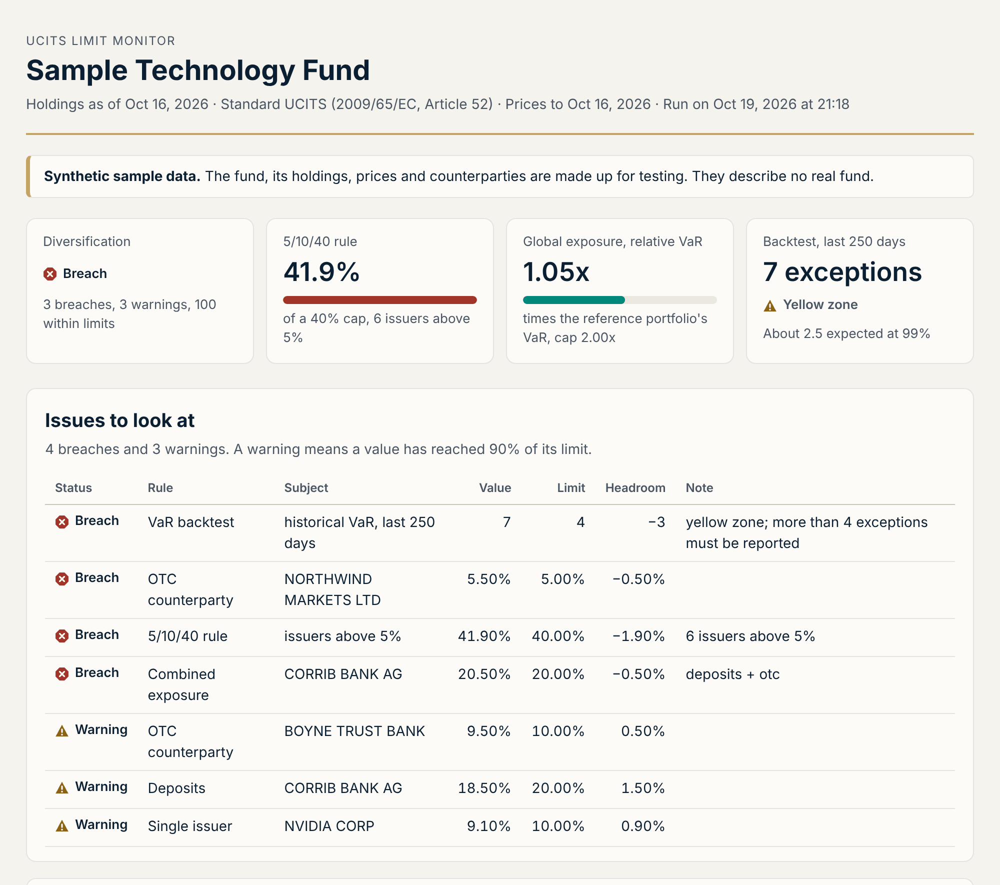
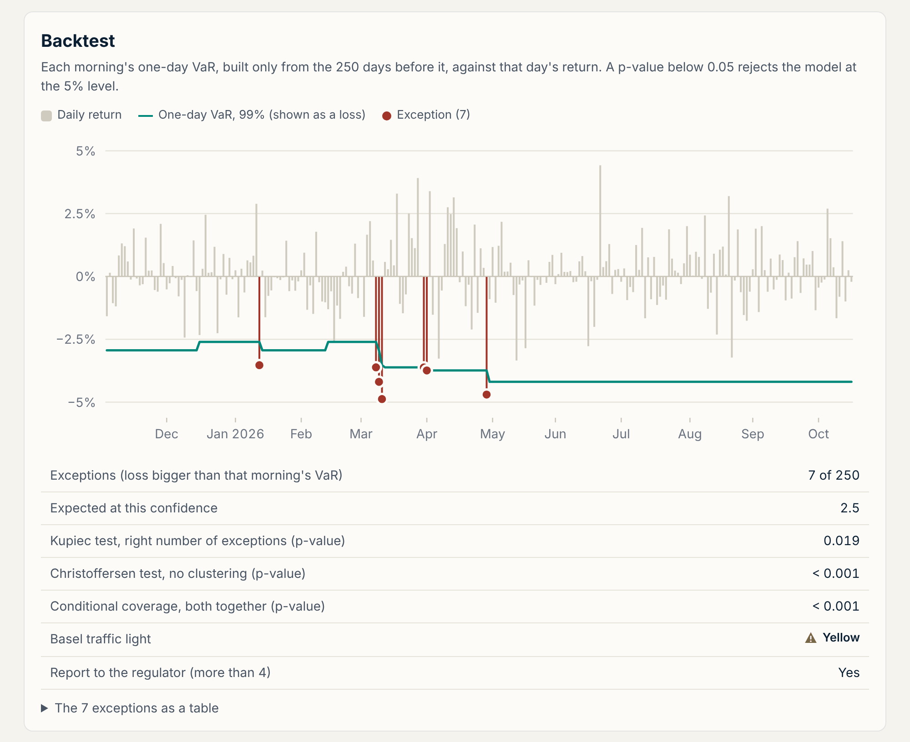

# UCITS limit monitor

[](https://github.com/sswnair/ucits-limit-monitor/actions/workflows/tests.yml)

Checks a UCITS fund against its investment limits using public data. It pulls an ETF's published holdings, tests them against the UCITS diversification rules, measures global exposure with Value at Risk and backtests the VaR model. The output is a one-page HTML report and a running log of breaches.

Fund administrators and depositaries run checks like these every morning. This is a compact version of that process, written in Python.



## What it checks

| Check | Limit | Source |
|---|---|---|
| Single issuer | 10% of NAV per issuer. Index trackers: 20%, and one issuer up to 35% in exceptional market conditions | UCITS Directive 2009/65/EC, Articles 52 and 53 |
| 5/10/40 rule | Issuers above 5% may not add up to more than 40% | Article 52 |
| Deposits | 20% with any one bank | Article 52 |
| OTC counterparty | 10% for credit institutions, 5% for anyone else | Article 52 |
| Combined exposure | Securities, deposits and OTC exposure to one body: 20% together | Article 52 |
| Global exposure, absolute VaR | 20-day 99% VaR at most 20% of NAV | CESR/10-788 |
| Global exposure, relative VaR | At most twice the VaR of an unleveraged reference portfolio | CESR/10-788 |
| Backtesting | More than 4 overshootings in 250 days at 99% must be reported | CESR/10-788 |

Limits apply to the issuer rather than the line item, so share classes count together: Alphabet's class A and class C shares are one issuer. Each result is marked OK, Warning (90% of a limit or more) or Breach.

## Quick start

```bash
git clone https://github.com/sswnair/ucits-limit-monitor.git
cd ucits-limit-monitor
python3 -m venv .venv && source .venv/bin/activate
pip install -e ".[dev]"

ucits-monitor report --sample      # synthetic data, works offline
```

Each run writes a self-contained HTML report, a findings CSV and a breach log to `output/`. With an internet connection, it also runs on real funds:

```bash
ucits-monitor report --fund CNDX                 # limits, VaR and backtest
ucits-monitor compare --fund CNDX                # the same holdings under every rule set
ucits-monitor var --fund CNDX --method parametric
ucits-monitor funds                              # what is configured
```

Add funds in `config/funds.json`. With `--fail-on-breach`, the `report`, `limits` and `var` commands exit with code 2 when anything breaches, which is handy in a scheduled job.

## The sample fund

The fund in `data/samples` is made up, with numbers chosen so that most rules flag something.

As a standard UCITS it fails the 5/10/40 rule. No single issuer is above 10%, but six of them sit above 5% and add up to 41.9%. Run `ucits-monitor compare --sample` and the same holdings pass as an index tracker. That is the room Article 53 gives concentrated index funds.

Northwind Markets, which is not a credit institution, breaches the 5% OTC counterparty limit on its own. Corrib Bank is the case the combined test exists for: it holds 18.5% of NAV on deposit and is also an OTC counterparty for 2%. Each is inside its own limit, but together they come to 20.5%, over the 20% cap for a single body.

The VaR model was beaten 7 times in 250 days, against about 2.5 expected. That puts it in the Basel yellow zone and over the 4 that have to be reported. Six of the seven fall in a volatile stretch from March to early May, three of them on consecutive days (Christoffersen p < 0.001). A 250-day historical window is slow to catch up when volatility jumps.

A normal-distribution VaR does worse on the same returns, with 10 exceptions and a red zone. The returns have fatter tails than the normal curve allows.



## How it works

```
data.py        download and parse holdings (iShares CSV) and prices (Stooq), with a local cache
issuers.py     clean security names into issuer keys; total weight per issuer
limits.py      the diversification checks
var.py         historical and parametric VaR, square-root-of-time scaling, rolling forecasts
backtest.py    Kupiec, Christoffersen and conditional coverage tests, Basel zones
exposure.py    absolute and relative VaR limits
engine.py      runs the checks in order and collects the findings
report.py      findings CSV, breach log and the HTML report
cli.py         the ucits-monitor command
```

VaR is historical simulation over the last 250 daily returns at 99%, scaled to 20 days by the square root of time. The backtest compares each morning's one-day VaR, built only from data available that morning, with that day's return.

## Data

| Input | Source |
|---|---|
| Holdings | The daily holdings file iShares publishes for each UCITS ETF |
| Prices | Daily closes from [Stooq](https://stooq.com) |
| Deposits and OTC counterparties | A CSV you supply. Public holdings files do not name the banks holding cash or the derivative counterparties, so an illustrative file with fictional names is included. |

Downloads are cached in `data/cache`, so a second run the same day works offline.

## Limitations

- Holdings come from the fund's published file, which can lag the administrator's books by a day.
- Cash, FX and futures lines are not counted toward issuer limits, and derivatives are not looked through to their underlyings.
- Issuers are grouped by name and a small ticker map. The directive treats companies in the same group as one body for some limits; this version does not.
- The combined 20% test runs for standard UCITS only. How it interacts with the raised index-tracker limits depends on national rules and the fund's own policy.
- Most plain equity ETFs measure global exposure with the commitment approach, not VaR. The VaR checks run on them here to show the method.
- National rules and a fund's prospectus can be stricter than the directive. This is a portfolio project, not compliance software.

## Tests

```bash
pytest
```

153 tests: each rule at and around its limits, the VaR and backtest statistics against hand-worked values, a check that the rolling forecast never uses the day it forecasts, and an end-to-end run on the sample.

---

Sanjay Nair, CFA · [sswnair.github.io](https://sswnair.github.io)
